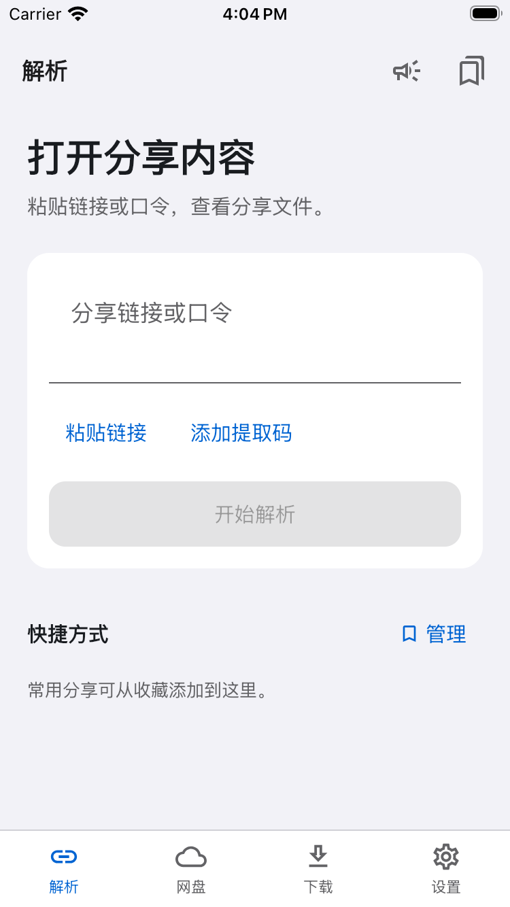
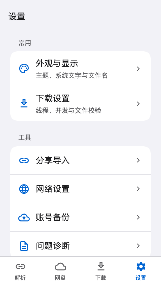

# iOS UI 适配与验证 · 构建 14

设备分发源码：`f613d97ffe231029716610b1318c382080c791e5`，版本 **0.1.1（14）**。[测试分发页](https://cc1477.github.io/YunX-iOS/)。

## 文字与布局

使用平台默认字体，完整定义标题、正文和标签的字号与行高。iOS 通过 `UIFont.preferredFont(forTextStyle: .body)` 读取系统字号比例，监听文字大小、粗体和应用回前台通知；Compose 只应用一次该比例。此比例用于所有文本角色，不等同于 UIKit 对每种文本样式分别使用的非线性缩放曲线。JVM 测试保留宿主提供的 fontScale。

设置首页按常用、工具、关于分组，具体选项进入详情页。线程、并发、代理和备份等功能保留，数字和文本设置通过编辑对话框确认保存。超大字号下，设置值放到标题下方；顶部预留换行空间。解析页使用一张输入卡片，提取码按需展开，辅助按钮可换行。底栏改为简单图标和文字，沿用安全区、横屏侧栏、键盘避让和滚动处理。

## 验证

[共享检查及原生模拟器运行](https://github.com/cc1477/YunX-iOS/actions/runs/38927568960)通过：23 项共享检查、0 失败，覆盖百度实际 HTTP 调用归一化、登录与下载回归、日志脱敏、分享收件缓冲，以及安全区与界面渲染。渲染包含四个主 Tab、六个设置详情页、320×568 小屏、375×667、667×375 横屏、平板、深浅色和最大 3.12 倍字号；此类渲染检查用于发现布局问题，不代表每个控件都经过自动点击验证。

原生 iPhone 模拟器完成安装、启动存活检查、标准字号、运行中切换最大辅助字号、最大字号冷启动及深色截图。字体测量记录：系统正文从 **17pt → 53pt**，Compose fontScale 从 **1.0 → 3.1176472**，实测一行文本高度从 **41px → 126px**。同时通过 Cookie 原值传输与轮换、诊断 ZIP 完整性和凭证脱敏，以及原生 UIKit 文件菜单显示检查。

上述模拟器提交为 `145b5a6`。最终设备包的 Kotlin 代码相同，仅额外将 Swift 分享扩展的完成按钮延迟到内容接收后启用。[最终设备构建与分发](https://github.com/cc1477/YunX-iOS/actions/runs/38928328088)通过；已重新下载公开 IPA，核对全包 SHA256、ZIP 完整性、真机平台及嵌入扩展与主程序版本一致。

系统分享菜单实际选择 YunX、第三方 App 接收文件和系统粗体切换仍需真机交互复测。模拟器的系统文件菜单测试使用合成诊断 ZIP，不包含真实账号。

## 截图

原生 iPhone 模拟器首页：

[原生最大辅助字号](docs/screenshots/ios-build14-large-live.png) · [原生文件菜单（测试 ZIP）](docs/screenshots/ios-build14-file-actions.png)

设置首页使用实际 Compose 布局引擎在 JVM 渲染，字体由该宿主提供：

