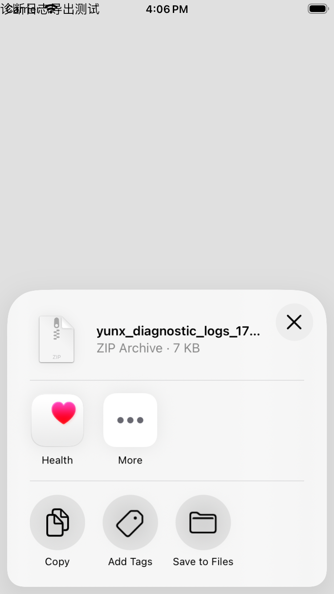

# 分享导入与文件打开 · 构建 14

## 从其他 App 导入分享链接

1. 在浏览器、聊天或其他 App 的系统分享菜单中选择 **YunX**。首次使用可在「更多」中启用。
2. 扩展接收链接或文本后提示已导入；点「完成」，返回 YunX。
3. YunX 切换到解析页，自动填入并解析；随分享文本提供的提取码会一并识别。

分享内容通过带 YunX 类型标记的本机剪贴板暂存一小时，不同步到其他设备。自动导入只读取该标记的内容，并以导入标识去重；如 iOS 提示粘贴权限，请选择允许。在导入前复制其他内容会覆盖暂存的分享，需要重新分享。分享扩展不会自动将主 App 切到前台；用户返回 YunX 后才开始解析。

扩展接受网页 URL 或文本，最多 64 KiB，不在扩展中登录、解析网络或发起下载。真实解析沿用主 App 已登录的网盘账号。

LCSign 签名时须保留并签名 `PlugIns/YunXShare.appex`，扩展 Bundle ID 需以主程序 Bundle ID 加点号为前缀。包内默认分别为 `com.yunx.app.ios` 与 `com.yunx.app.ios.share`。

## 下载完成后选择应用

在已完成任务上点击「打开方式」图标，或长按任务后选择「打开方式」。独立下载和文件夹内的子文件均可使用。

iOS 原生文件菜单提供兼容的已安装应用，可点「更多」查看，也可选择「存储到文件」。菜单按文件类型和已安装应用生成；本次选择不设置系统默认应用。实现使用本地文件 URL，避免将路径直接拼成网页 URL，中文、空格等由系统编码。文件被删除或菜单未能显示时会提示错误，不改变任务状态。

原生菜单截图来自模拟器的合成 ZIP：

[Apple 原生文件分享说明](https://developer.apple.com/documentation/uikit/collaborating-and-sharing-copies-of-your-data)。
